<div align="center">

# 🦁 XXD Shop 003｜异形推荐牌

### 一枚从商品里长出来的视觉徽章

<strong>简体中文</strong> · <a href="README.en.md">English</a> · <a href="README.ja.md">日本語</a> · <a href="README.ko.md">한국어</a> · <a href="README.ar.md">العربية</a>

</div>

**做一枚从商品里“长”出来的异形推荐牌，不再是千篇一律的圆角卡片。**
牌子的外形由商品轮廓、名字字形和几块信息一起决定，远看就能认出商品和名字。

| 一眼看懂 | |
|---|---|
| **交给它** | 商品名称（必需）＋商品图（推荐）；价格、规格、口味等信息 |
| **你拿到** | 放在干净单色底上的推荐牌 PNG，可直接贴进详情页或做成店内物料；需要时另出透明底 |
| **风格特点** | 异形外轮廓 · 商品咬进牌面 · 有性格的商品名 · 信息块长在结构里 · 少量趣味小图形 |
| **最适合** | 详情页推荐模块、店内推荐卡、价格牌、新品角标 |

> **装好后，直接这样说：**
>
> /xxd-shop-003 这是海盐芝士贝果，16 元一个 120g，做一枚推荐牌

<!-- xxd-samples:start -->
## 样张

<p align="center"><a href="assets/examples/s01-size-1x1-1254x1254.png"></a><br><sub>详情页模块 · 1:1 · 1254x1254<br>野蜂坡 百花蜜 · <a href="assets/examples/sources/product-yfp-honey.jpg">商品图</a> + <a href="assets/examples/sources/logo-yefengpo.png">Logo</a> · 文案方案（中文）</sub></p>

### 能做哪些品类

每格一个品类，点开看大图；下面各段有用途、比例、像素和输入说明。

<table>
<tr><td align="center" valign="top"><a href="assets/examples/c01-category-3x4-1086x1448.png">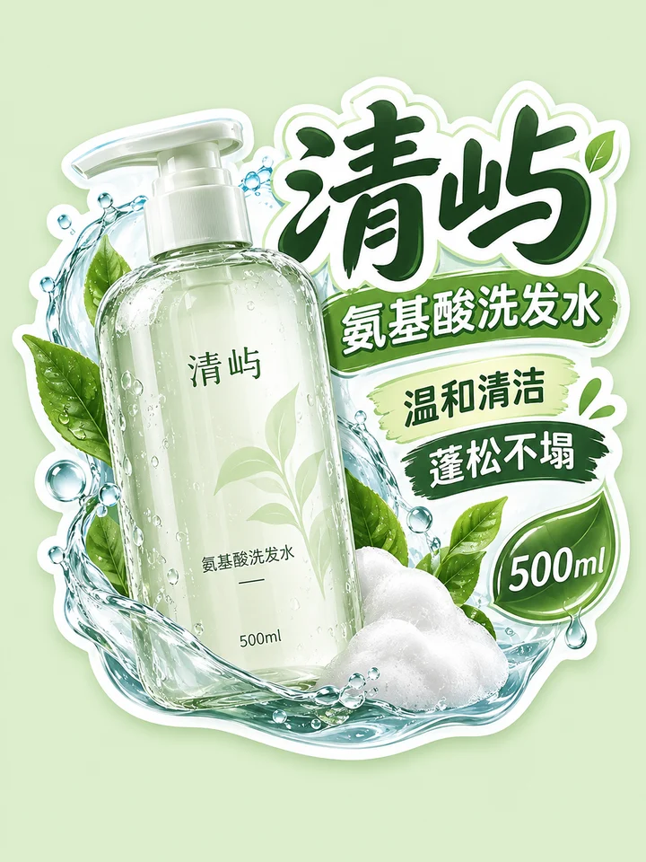</a><br><sub><b>个护清洁</b><br>货架牌</sub></td><td align="center" valign="top"><a href="assets/examples/c02-category-1x1-1254x1254.png">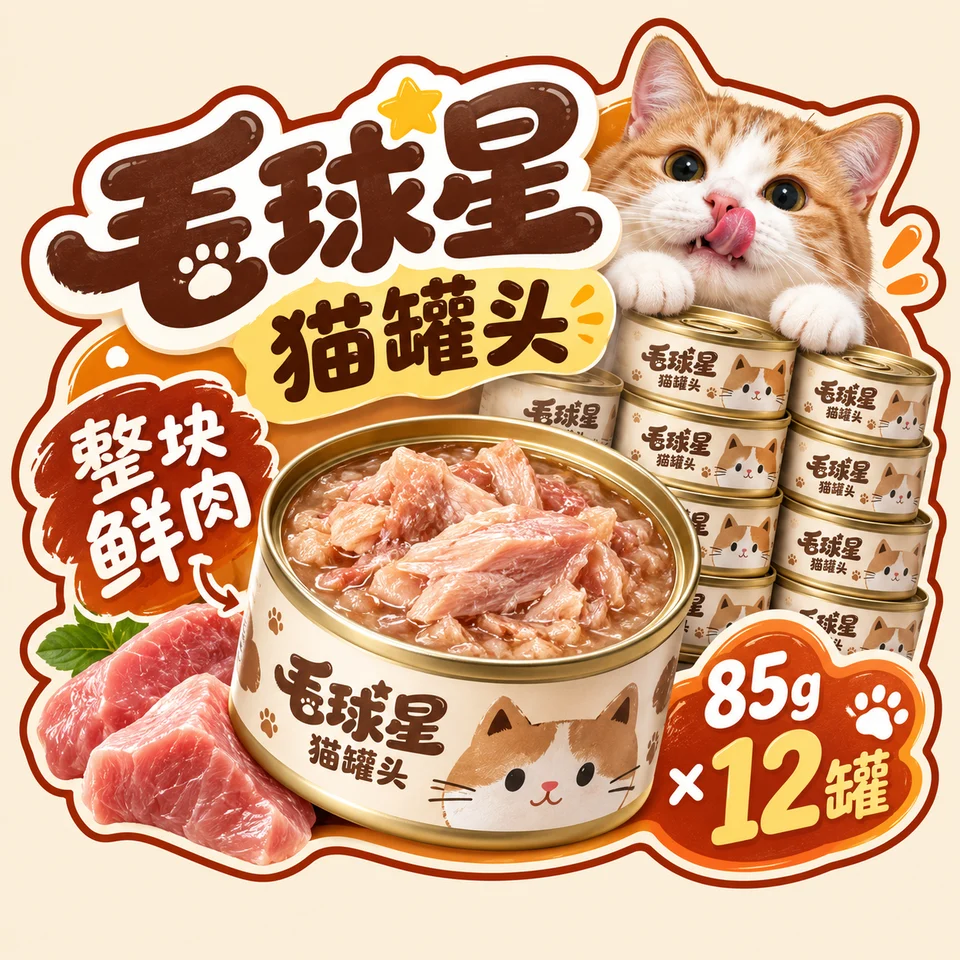</a><br><sub><b>宠物</b><br>详情页模块</sub></td><td align="center" valign="top"><a href="assets/examples/c03-category-1x1-1254x1254.png">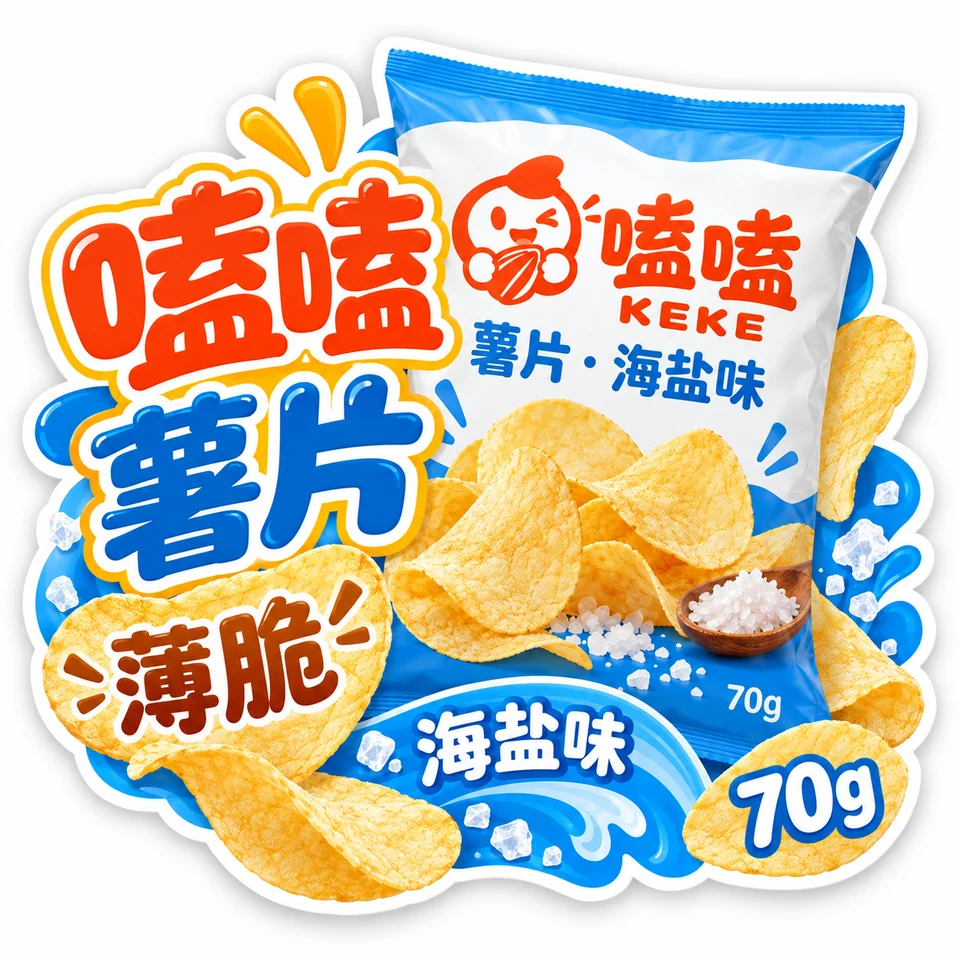</a><br><sub><b>零食</b><br>详情页模块</sub></td><td align="center" valign="top"><a href="assets/examples/c04-category-3x4-1086x1448.png">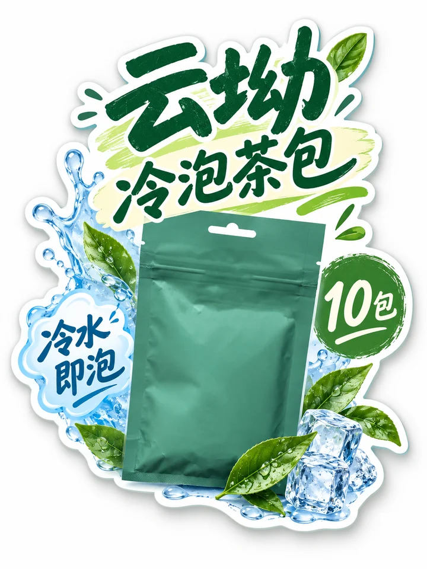</a><br><sub><b>茶饮</b><br>货架牌</sub></td><td align="center" valign="top"><a href="assets/examples/c05-category-4x5-1122x1402.png">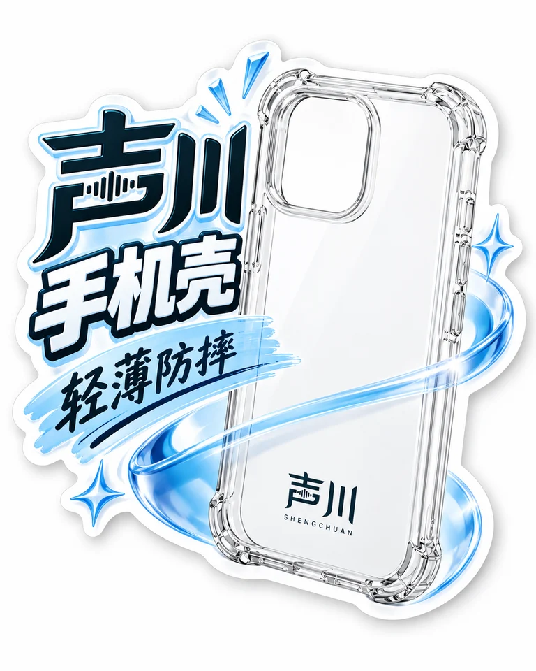</a><br><sub><b>3C 数码</b><br>详情页模块</sub></td><td align="center" valign="top"><a href="assets/examples/s01-size-1x1-1254x1254.png"></a><br><sub><b>食品</b><br>详情页模块</sub></td></tr>
<tr><td align="center" valign="top"><a href="assets/examples/s05-special-3x4-1086x1448.png">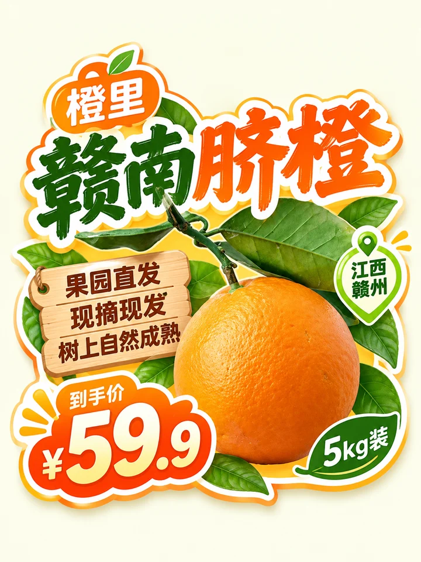</a><br><sub><b>生鲜</b><br>货架牌</sub></td><td align="center" valign="top"><a href="assets/examples/s06-special-1x1-1254x1254.png">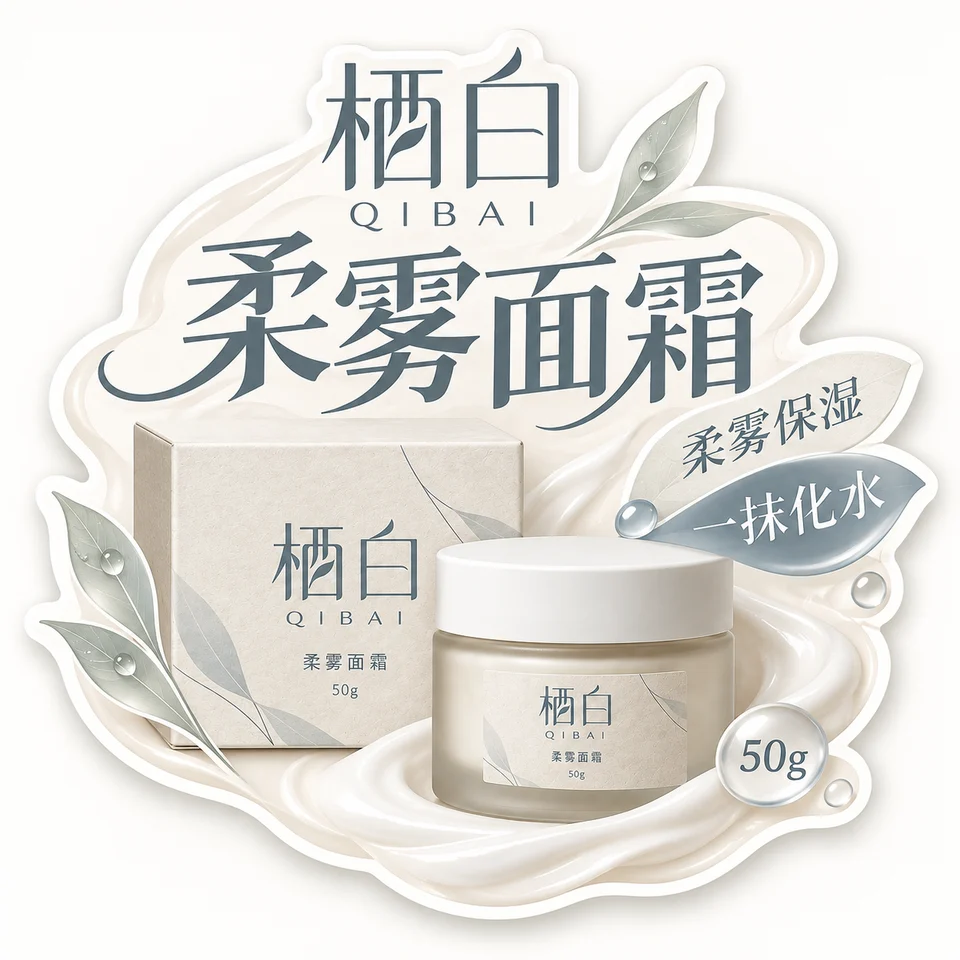</a><br><sub><b>护肤</b><br>详情页模块</sub></td><td align="center" valign="top"><a href="assets/examples/s07-special-3x4-1086x1448.png">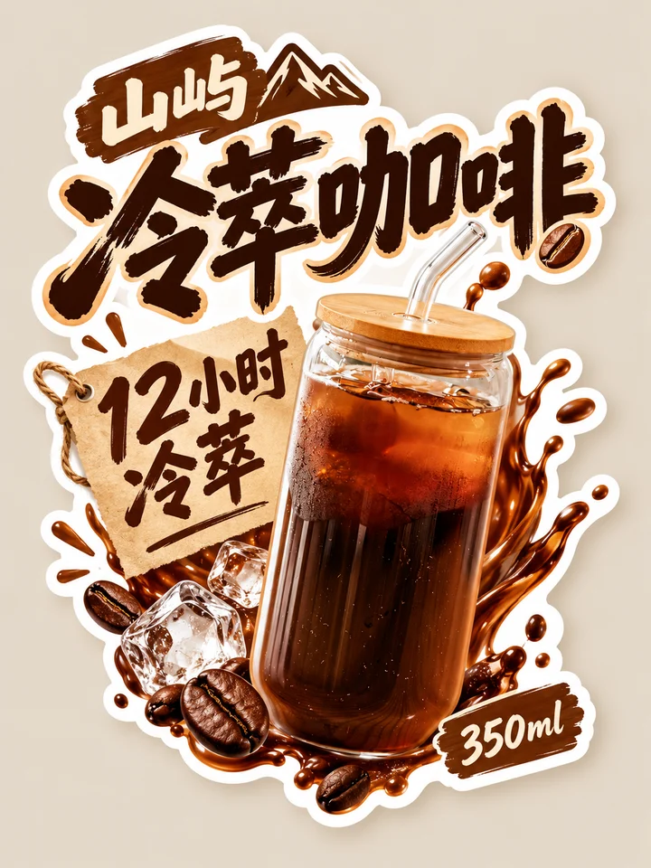</a><br><sub><b>咖啡</b><br>货架牌</sub></td></tr>
</table>

### 一个商品，适配每个位置

同一商品、同一套风格，每个比例都重新构图，不是裁切。

<table>
<tr><td align="center" valign="top"><a href="assets/examples/s01-size-1x1-1254x1254.png"></a><br><sub>详情页模块 · 1:1 · 1254x1254<br>野蜂坡 百花蜜 · <a href="assets/examples/sources/product-yfp-honey.jpg">商品图</a> + <a href="assets/examples/sources/logo-yefengpo.png">Logo</a> · 文案方案（中文）</sub></td><td align="center" valign="top"><a href="assets/examples/s02-size-3x4-1086x1448.png">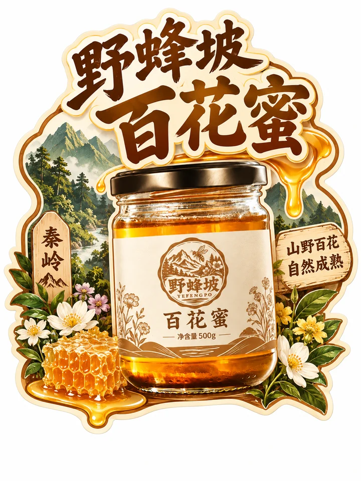</a><br><sub>货架牌 · 3:4 · 1086x1448<br>野蜂坡 百花蜜 · <a href="assets/examples/sources/product-yfp-honey.jpg">商品图</a> + <a href="assets/examples/sources/logo-yefengpo.png">Logo</a> · 文案方案（中文）</sub></td><td align="center" valign="top"><a href="assets/examples/s03-size-9x16-941x1672.png">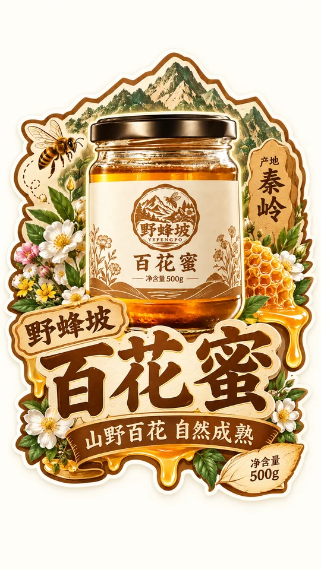</a><br><sub>店内竖屏 · 9:16 · 941x1672<br>野蜂坡 百花蜜 · <a href="assets/examples/sources/product-yfp-honey.jpg">商品图</a> + <a href="assets/examples/sources/logo-yefengpo.png">Logo</a> · 文案方案（中文）</sub></td><td align="center" valign="top"><a href="assets/examples/s04-size-16x9-1672x941.png"></a><br><sub>横幅 · 16:9 · 1672x941<br>野蜂坡 百花蜜 · <a href="assets/examples/sources/product-yfp-honey.jpg">商品图</a> + <a href="assets/examples/sources/logo-yefengpo.png">Logo</a> · 文案方案（中文）</sub></td></tr>
</table>

### 换一个品类也成立

<table>
<tr><td align="center" valign="top"><a href="assets/examples/c01-category-3x4-1086x1448.png"></a><br><sub>货架牌 · 3:4 · 1086x1448<br>清屿 氨基酸洗发水 · <a href="assets/examples/sources/product-qy-shampoo.jpg">商品图</a> + <a href="assets/examples/sources/logo-qingyu.png">Logo</a> · 文案方案（中文）</sub></td><td align="center" valign="top"><a href="assets/examples/c02-category-1x1-1254x1254.png"></a><br><sub>详情页模块 · 1:1 · 1254x1254<br>毛球星 猫罐头 · <a href="assets/examples/sources/product-mqx-can.jpg">商品图</a> + <a href="assets/examples/sources/logo-maoqiuxing.png">Logo</a> · 文案方案（中文）</sub></td><td align="center" valign="top"><a href="assets/examples/c03-category-1x1-1254x1254.png"></a><br><sub>详情页模块 · 1:1 · 1254x1254<br>嗑嗑 薯片 · <a href="assets/examples/sources/product-keke-chips.jpg">商品图</a> + <a href="assets/examples/sources/logo-keke.png">Logo</a> · 文案方案（中文）</sub></td></tr>
<tr><td align="center" valign="top"><a href="assets/examples/c04-category-3x4-1086x1448.png"></a><br><sub>货架牌 · 3:4 · 1086x1448<br>云坳 冷泡茶包 · <a href="assets/examples/sources/product-yunao-coldtea.jpg">商品图</a> + <a href="assets/examples/sources/logo-yunao.png">Logo</a> · 文案方案（中文）</sub></td><td align="center" valign="top"><a href="assets/examples/c05-category-4x5-1122x1402.png"></a><br><sub>详情页模块 · 4:5 · 1122x1402<br>声川 手机壳 · <a href="assets/examples/sources/product-sc-case.jpg">商品图</a> + <a href="assets/examples/sources/logo-shengchuan.png">Logo</a> · 文案方案（中文）</sub></td><td align="center" valign="top"><a href="assets/examples/c06-category-1x1-1254x1254.png">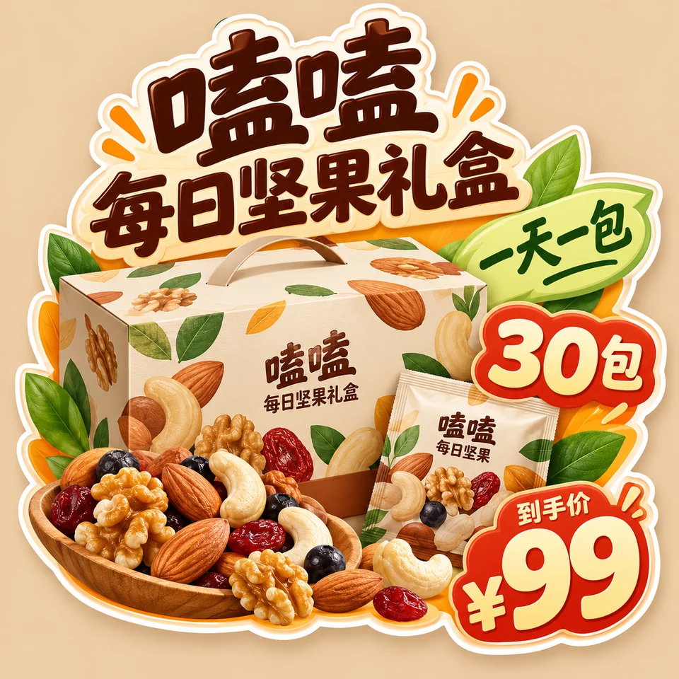</a><br><sub>货架牌 · 1:1 · 1254x1254<br>嗑嗑 每日坚果礼盒 · <a href="assets/examples/sources/product-keke-nuts.jpg">商品图</a> + <a href="assets/examples/sources/logo-keke.png">Logo</a> · 文案方案（中文）</sub></td></tr>
</table>

### 牌子从商品形态长出来

<table>
<tr><td align="center" valign="top"><a href="assets/examples/s05-special-3x4-1086x1448.png"></a><br><sub>货架牌 · 3:4 · 1086x1448<br>橙里 赣南脐橙 · <a href="assets/examples/sources/orange.jpg">原图</a> + <a href="assets/examples/sources/logo-chengli.png">Logo</a> · 文案方案（中文）</sub></td><td align="center" valign="top"><a href="assets/examples/s06-special-1x1-1254x1254.png"></a><br><sub>详情页模块 · 1:1 · 1254x1254<br>栖白 柔雾面霜 · <a href="assets/examples/sources/product-qibai-cream.jpg">商品图</a> + <a href="assets/examples/sources/logo-qibai.png">Logo</a> · 文案方案（中文）</sub></td><td align="center" valign="top"><a href="assets/examples/s07-special-3x4-1086x1448.png"></a><br><sub>货架牌 · 3:4 · 1086x1448<br>山屿 冷萃咖啡 · <a href="assets/examples/sources/product-shanyu-coldbrew.jpg">商品图</a> + <a href="assets/examples/sources/logo-shanyu.png">Logo</a> · 文案方案（中文）</sub></td><td align="center" valign="top"><a href="assets/examples/s08-special-1x1-1254x1254.png">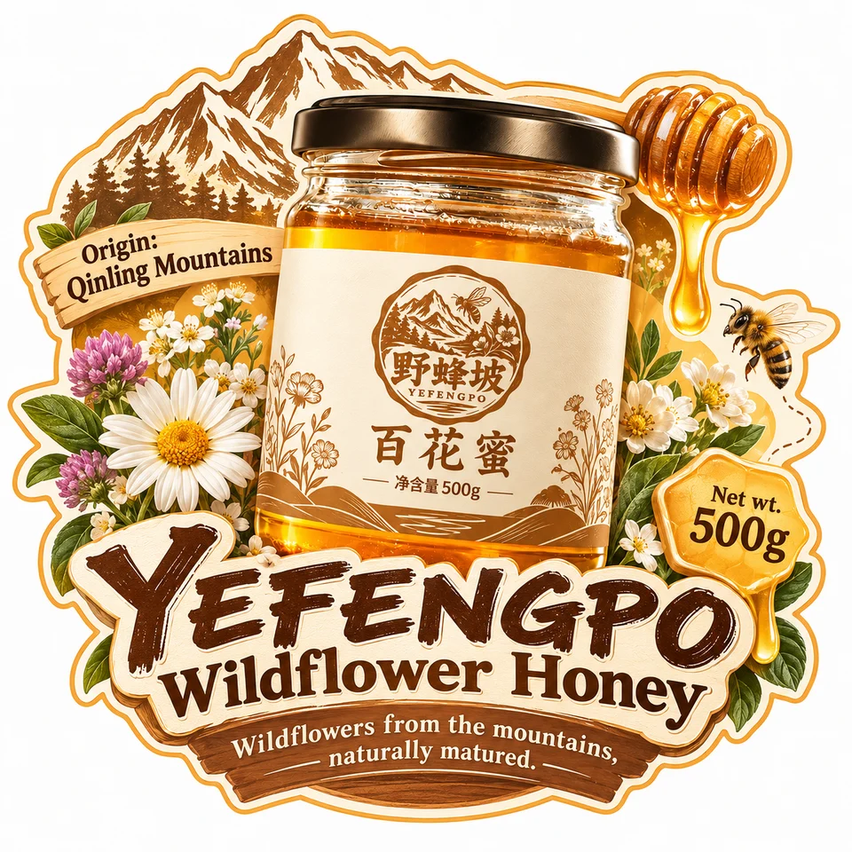</a><br><sub>详情页模块 · 1:1 · 1254x1254<br>野蜂坡 百花蜜 · <a href="assets/examples/sources/product-yfp-honey.jpg">商品图</a> + <a href="assets/examples/sources/logo-yefengpo.png">Logo</a> · 文案方案（英文）</sub></td></tr>
</table>

<sub>样张商品均为虚构的演示品牌，价格、规格等数字为演示设定；演示商品图与 Logo 由本项目生成，部分以 Unsplash 照片为底，署名与许可见 [assets/examples/README.md](assets/examples/README.md)。每张都是单次生成的完整画面，未修图、未拼接、未放大，像素照实标注；没通过目视验收的已重出，不放进来。点开看原尺寸。</sub>

<!-- xxd-samples:end -->

## 它解决什么

详情页和店内推荐卡最常见的样子是：一张圆角卡片，中间放商品照片，下面三行字。信息都有，但谁也记不住。

**Shop 003** 不从卡片模板出发。牌子的外形由**商品轮廓、名字字形和几块信息**一起决定：商品可以从边缘探出来，名字可以绕着商品转，价格可以是一枚小签，口味可以是一条丝带。最后是一整块图形，而不是几样东西贴在底板上。

远看先认出商品和名字，再看到价格或卖点，凑近才发现口味、规格和小趣味。

## 你需要准备

- **商品名称**（必需）：名字本身就是轮廓的一部分。
- **商品图**（推荐）：抠图、越界、穿插都靠它。
- **价格、规格、口味、原料**（推荐）：给得越准，信息块越好看。没给价格，牌子上就没有价格签，也不会出现“¥XX”占位。
- **你自己的卖点文案**（可选）：给了就按你的；没给它会先起草一份给你看。

## 怎么用

### 第一步：安装（只需一次）

```bash
git clone https://github.com/nevertoday/xxd-shop-003.git
mkdir -p ~/.claude/skills
ln -s "$(pwd)/xxd-shop-003" ~/.claude/skills/xxd-shop-003
```

Codex 用户把同一个文件夹链接到 `~/.codex/skills/xxd-shop-003`。装好后重开一次 AI 助手的会话。

### 第二步：用大白话说出你要什么

```text
/xxd-shop-003 这是海盐芝士贝果，16 元一个 120g，做一枚推荐牌
/xxd-shop-003 冻干草莓脆，卖点是整颗冻干、不加糖、酸甜脆口，一袋 30g
/xxd-shop-003 ~/Desktop/新品SKU 里每件商品各做一枚 4:5 的推荐牌
```

不用记参数。没说清的事（比如尺寸、张数），它会一次问齐；第二次用时可以直接沿用上次的设置。

### 第三步：它会这样做

1. 看你的商品图和描述，只问还没定的事；尺寸会按用途推荐比例，并告诉你像素。
2. 没给文案时，先按牌面的信息块起草一份文案，每句标明出处（你的描述、包装上的字或你给的信息），你确认或改过再出图。
3. 每个尺寸都重新构图，不是从一张图裁出来的。
4. 交付前逐张检查：商品有没有被改、字有没有写错、有没有多出你没给的数字。不通过的会告诉你并重做。
5. PNG 存进 `~/Desktop/xxd/xxd-shop-003/` 下新建的任务文件夹，把路径告诉你。

<details>
<summary><strong>进阶：命令参数写法（熟练后再看）</strong></summary>

```text
# 商品图 + 价格规格：先起草牌面文案给你确认，再出图（默认）
/xxd-shop-003 ./海盐芝士贝果.png --product "海盐芝士贝果" --facts "¥16；单个 120g" --size 1:1 --locale zh-CN

# 你有一整段卖点文案，让它按牌面层级理顺
/xxd-shop-003 ./冻干草莓.png --product "冻干草莓脆" --text plan --copy "整颗冻干 不加糖 酸甜脆口 一袋 30g 办公室零食" --locale zh-CN

# 一套 SKU，每件一枚推荐牌；每件各起草一份文案，一次确认
/xxd-shop-003 ~/Desktop/新品SKU/ --size 4:5 --locale zh-CN
```

常用参数：`--product` · `--facts` · `--text prompt / exact / plan / none` · `--copy` · `--size` · `--count` · `--locale`。完整参数见[运行说明](references/shop-runtime.md)。

</details>

## 常见问题

**要透明底怎么办？**

直接说要透明底。成品先在单色底上生成，再抠图交付，不会画一个假的灰白棋盘格。

**“店长推荐”“人气款”会自己加上吗？**

不会。这类说法会被顾客当成真的推荐，只有你说过才用。“爆浆、现烤、低甜”这类属性词，也只在看得出来或你说过时出现。

**需要什么才能用？**

三样东西：① 一个支持 Skills 的 AI 助手，比如 Claude Code 或 Codex；② 一个能出图的模型，可以是助手自带的出图能力，也可以是在 Codex 里配置好的、通过 Responses 接口出图的模型供应商（默认用 GPT Image 2）；③ 电脑上装有 Python 3.11 以上和 Pillow（`pip install pillow`）。

**要花钱吗？能商用吗？**

Skill 本身免费下载，出图费用由你自己的模型账户承担。给自己的商品、店铺、品牌出图（包括作为员工给任职公司出图）可以直接商用，不用申请；转卖 Skill、做成付费服务、收费帮别人出图，需要先取得作者的书面授权。详见文末“许可证”。

**出来的图有多大？**

你可以指定比例或准确像素。实际像素以模型返回为准，不会偷偷放大冒充高清，文件名里写的就是真实像素。

**图里的字会写错吗？**

AI 出图偶尔会写错字，或在品牌名旁多出 ® 这类小符号。交付前会逐张放大检查，发现问题就重做那一张；本页的样张都过了这一步。

**会不会乱写价格、销量？**

不会。画面上像事实的内容（价格、规格、产地、销量、获奖、认证……）只来自你提供的信息或商品图上看得清的字；没给就不写，也不放“¥XX”这种占位。

**能一次处理很多商品吗？**

能。把商品图文件夹交给它，每张图当作一件商品，尺寸和文字设置只问一次；每件商品的信息和文案互不串用。

## 它的原则

- **风格不走样：** 这款背后是一份成熟的商业设计提示词（[设计原文](references/original-prompt/zh-CN.md) · [English](references/original-prompt/en.md)）。Skill 不改写它，也不另加配色和美术指导，只把你的商品、尺寸、文字和事实交给模型。
- **商品不改款：** 有商品图时，造型、颜色、包装文字和 Logo 以图为准。
- **只用你给的事实，** 每件商品各管各的，不借用别的商品、旧成品或样张里的内容。
- **交付真实的 PNG 位图，** 不用 SVG 或代码绘图冒充；每次调用都新建任务文件夹。
- 一枚牌只讲一件商品；组合装可以把组合当成一件商品来命名。

<!-- xxd-shop-tail -->
<details>
<summary><strong>项目结构（给开发者）</strong></summary>

```text
xxd-shop-003/
├── SKILL.md
├── README.md / README.en.md / README.ja.md / README.ko.md / README.ar.md
├── LICENSE
├── agents/openai.yaml
├── assets/examples/
├── scripts/
│   ├── configured_imagegen.py
│   ├── clean_marks.py
│   └── shop_preferences.py
└── references/
    ├── shop-runtime.md
    ├── runtime-preferences.md
    ├── sample-workflow.md
    └── original-prompt/
        ├── README.md
        ├── zh-CN.md
        └── en.md
```

</details>

<!-- xxd-readme-ads:start -->
## 关于 XXD

XXD 是小小东品牌名的缩写，本项目由小小东创建并维护：[@xiaoxiaodong01](https://x.com/xiaoxiaodong01)。

## 小小东多端会员 · 699 元/年

> **广告与商业信息声明：** 以下二维码、会员与付费服务链接属于小小东的广告信息。是否扫码或购买完全自愿，不影响本开源项目的访问与使用。

一次年费，同时开通三项会员权益：**知识星球 + 小小东成员提示词库 + 全部 将军总指挥 Skills 会员**。三项权益合并在同一份会员中，无需分别购买。

<!-- xxd-shop-command-system:start -->

### Skills 如何协作

| 层级 | 包含内容 | 用途 |
|---|---|---|
| **General** | `xxd-shop-all` | 识别可用的编号 Skills，按商品、用途和画面需求推荐，并组织多风格试稿与批量任务。 |
| **Soldier** | `xxd-shop-NNN` | 每个编号执行自己的原始提示词与审美，完成 General 分派的具体任务。 |

<!-- xxd-shop-command-system:end -->

### 会员权益

1. **微信一对一 AI 学习与项目答疑**
   扫描下方二维码，添加小小东微信，围绕 AI 学习、工具使用和实际项目进行一对一沟通，获得答疑与建议；代表性问题将整理为会员内容。
2. **持续更新的成员提示词库**
   [小小东成员提示词库](https://vip.xiaoxiaodong.ai/)当前约有 3.2 万条提示词，会持续整理和扩充，目标超过 10 万条。
3. **全部 将军总指挥 Skills 与使用答疑**
   一份会员覆盖全部 将军总指挥 Skills；使用过程中遇到问题，可以获得相应的使用说明与答疑。
4. **高频刚需优先处理**
   会员提出的高频、刚需提示词与 Skills 需求，会优先评估和开发。

### 如何开通

- 可在[成员网站](https://vip.xiaoxiaodong.ai/)自助开通。
- 也可以扫描下方二维码，添加小小东微信，进行一对一沟通并获得开通协助。

<p align="center"><a href="https://xiaoxiaodong.pages.dev/assets/wechat-qr.png"></a></p>
<!-- xxd-readme-ads:end -->

## 许可证

本项目（包括 Skill、提示词、脚本、文档及随附样张）采用 **PolyForm Noncommercial License 1.0.0**，并附加一条“自家生意使用”许可（写在 [LICENSE](LICENSE) 开头）。完整法律条文请见 [LICENSE](LICENSE)，官方页面见 <https://polyformproject.org/licenses/noncommercial/1.0.0>。

用人话说：

- **卖家自用免费：** 给你自己的商品、店铺、品牌出图，或者作为员工给任职公司的出图，可以直接用，也可以改 Skill 来适配；出的图可以上架、投广告、印包装，商用不用另外申请。
- 个人学习、研究、实验、测试、兴趣项目和私人娱乐可以使用；慈善机构、教育机构、公共研究/安全/卫生机构、环保组织及政府机构也可以使用。
- 在**非商业目的**下，你可以复制、修改、制作衍生作品并分享；分享时必须同时提供本许可证（含附加许可）以及其中所有 `Required Notice:` 声明。
- **以下用途要先取得书面商业授权：** 转卖或收费分发 Skill、提示词及其改编版；做成付费工具、在线服务或 API；收费帮别人出图（设计工作室、代运营、接单）；用作付费课程或培训材料。商业授权请联系 [@xiaoxiaodong01](https://x.com/xiaoxiaodong01) 或扫上方二维码。
- 本协议只授予其中明确写出的著作权许可和有限的专利许可，不授予商标、品牌名称或其他未明确授予的权利，也不能把你的许可再转授给他人。
- 如果收到书面违约通知，须在 32 天内纠正并采取实际补救措施，否则许可会立即终止；就专利侵权提出书面主张也会终止专利许可。
- 内容按“现状”提供，在法律允许的范围内不作任何担保，使用风险和可能的损失由使用者自行承担。
